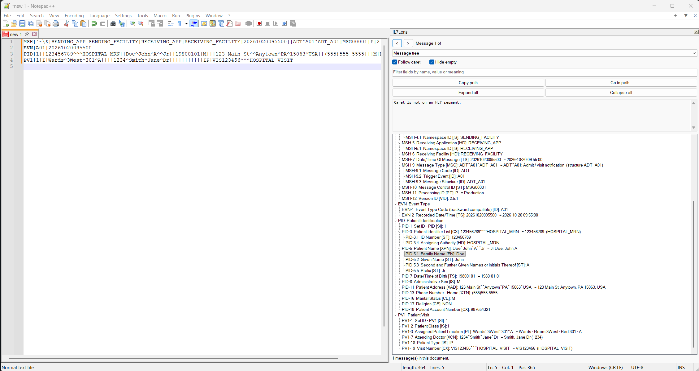

<div align="center">

# HL7Lens

**Read HL7 v2 messages in plain language, right inside Notepad++.**

Put the caret anywhere in a message and HL7Lens tells you where you are, what the field is called,
its data type, its value and what that value means.

[](LICENSE)


[](https://buymeacoffee.com/jcinc)



</div>

---

## Contents

- [Why HL7Lens](#why-hl7lens)
- [Install](#install)
- [Features](#features)
- [Compare two messages](#compare-two-messages)
- [Version-aware field names](#version-aware-field-names)
- [Custom segments (Z-segments)](#custom-segments-z-segments)
- [Command line](#command-line)
- [Build from source](#build-from-source)
- [Signature](#signature)
- [Privacy](#privacy)
- [Questions and feedback](#questions-and-feedback)
- [Support development](#support-development)
- [License](#license)

## Why HL7Lens

Most people who work with HL7 v2 interfaces read the messages in Notepad++. A raw message is a wall of
pipes and carets: `PID|1||123456^^^HOSP^MR~77^^^OTHER^PI||DOE^JANE^M||19800101|F`. HL7Lens turns that
into something you can read without counting separators, and it never sends a byte anywhere.

## Install

### Easiest: the Run box (no typing commands)

1. Close Notepad++.
2. Press **Windows key + R** to open the Run box.
3. Paste this line and press **Enter**:

```text
powershell -NoExit -c "irm https://raw.githubusercontent.com/Subzero121800/HL7Lens/main/install.ps1|iex"
```

A blue window opens, installs HL7Lens and says where it went. Close it, start Notepad++ and press **Ctrl+Alt+H**.
If Windows asks *"Do you want to allow this app to make changes?"*, that is the copy into Notepad++'s folder: choose **Yes**.

### Work computers without admin rights (State, Federal, hospital PCs)

On most managed PCs Notepad++ is installed under `C:\Program Files`, and Windows only lets an administrator add
files there. That is a Windows rule, not something HL7Lens can work around, and Notepad++ only loads plugins from
its own `plugins` folder.

Run the same line above anyway. If you have no admin rights (or you choose **No** at the prompt), the installer still
downloads and checks HL7Lens and leaves a folder in your **Downloads** called **`HL7Lens-for-IT`** with:

- the ready-to-copy `HL7Lens` plugin folder, and
- `README-for-IT.txt`: exactly where it goes, the file's SHA-256, the signer, and what the plugin does (offline,
  no network connections, no telemetry).

Attach that note to an IT ticket. Copying one folder is a two-minute job for IT, and the note gives them what a
software review usually asks for. IT can also deploy it to many PCs silently (as administrator or SYSTEM):
`powershell -NoProfile -ExecutionPolicy Bypass -File install.ps1 -ZipPath <release zip>`.

If your agency blocks PowerShell entirely, use **Manual** below and send IT the `x64\HL7Lens` folder from the zip.

### One command (PowerShell)

Close Notepad++, open PowerShell and run:

```powershell
irm https://raw.githubusercontent.com/Subzero121800/HL7Lens/main/install.ps1 | iex
```

The installer finds Notepad++, picks the 64-bit or 32-bit build to match it, downloads the latest
release, checks its SHA-256 checksum and that the DLL is signed by the author, then copies it to
`plugins\HL7Lens\`. It asks for administrator approval only when the plugins folder needs it.

| Option | What it does |
| --- | --- |
| `-NppPath D:\Tools\npp` | Portable Notepad++ (the folder that holds `notepad++.exe`) |
| `-Version 1.1.0` | A specific release instead of the latest |
| `-ZipPath .\HL7Lens_NotepadPlusPlus_v1.1.0.zip` | Install from a zip you already downloaded |
| `-Force` | Close a running Notepad++ first |
| `-Uninstall` | Remove the plugin (settings stay in `plugins\Config\HL7Lens`) |

To pass options, download the script first: `irm https://raw.githubusercontent.com/Subzero121800/HL7Lens/main/install.ps1 -OutFile install.ps1`, then `.\install.ps1 -NppPath ...`.

### From the release zip

Unzip the release, close Notepad++ and double-click **`install.cmd`**. It installs the files beside it (no
download) and runs PowerShell with `-ExecutionPolicy Bypass` for that one run, so Windows' default
*"running scripts is disabled on this system"* policy does not block it. Options work here too:
`install.cmd -NppPath D:\Tools\npp`, `install.cmd -Uninstall`.

### Manual

1. Download `HL7Lens_NotepadPlusPlus_vX.Y.Z.zip` from [Releases](https://github.com/Subzero121800/HL7Lens/releases).
2. Check your Notepad++ under **? > About Notepad++** (64-bit or 32-bit).
3. Drag `x64\HL7Lens` (or `x86\HL7Lens`) into Notepad++'s `plugins` folder, so you end up with
   `...\plugins\HL7Lens\HL7Lens.dll`.
4. Start Notepad++ and press **Ctrl+Alt+H**.

Optional: **Plugins > HL7Lens > Install HL7 v2 syntax colors**, then restart Notepad++ once; `.hl7` files then color automatically.

## Features

**Decoder panel** (Ctrl+Alt+H, docks on the right)

- **Live readout** of the field under the caret: path (`PID-3(2).1`), field and component names, data
  type, repetition (`Repetition 2 of 3`), unescaped value and plain-language meaning.
- **Message tree**: summary, then segment > field > repetition > component > subcomponent. Click a node to
  select it in the editor; move the caret and the tree follows.
- **Meanings**: names (`DOE, JANE M`), addresses, phone numbers, timestamps with time zone and age, code
  tables (sex, patient class, result status, abnormal flags ...), coding systems (LOINC, SNOMED CT ...)
  and message types (`ORU^R01 = Unsolicited observation result`).
- **Validation**: missing MSH-9/10/12, bad segment IDs, invalid timestamps, non-numeric NM values, missing
  required segments, version drift, wrapped lines, and fields the declared version does not define.
- **Version and ELR checks**: declared version against the features actually used, backward-compatible
  fields, and electronic lab reporting readiness.
- **Filter**, **Hide empty**, **Expand all / Collapse all**.

**Navigation**

| Command | Shortcut |
| --- | --- |
| Go to field path (`PID-3.1`, `OBX[2]-5`, `PID-3(2).4`) | Ctrl+Alt+G |
| Next / previous field (each repetition is a stop) | Ctrl+Alt+Right / Left |
| Next / previous message | Ctrl+Alt+PgDn / PgUp |
| Mark a field in every segment, list a field across every message | menu |

**Tools** (Plugins > HL7Lens): decoded report, JSON export, ACK builder (AA/AE/AR), de-identified copy,
repair (MLLP framing, blank and wrapped lines, smart quotes; undoable), escape and unescape
(`\F\ \S\ \T\ \R\ \E\ \.br\ \Xhh\`), segment separators to CRLF or CR.

**Handles** CR, LF and CRLF separators, many messages per file (each with its own MSH separators),
FHS/BHS batches, custom encoding characters, MLLP framing and Z-segments.

## Compare two messages

Interface work is mostly *"why did this one fail when that one worked?"*

- **Compare message at caret with another message in this file...**
- **Compare message at caret with the clipboard**
- **Compare message at caret with the other view** (open both files side by side: right-click a tab >
  Move Document > Move to Other View)

The report opens in a new tab:

```text
Summary: 3 value difference(s), 0 segment(s) only in A, 1 segment(s) only in B, 4 segment(s) matched.

DIFFERENT VALUES
  PID-5.2         Patient Name > Given Name
      A: JANE
      B: JOHN
  OBR-44(2)       Procedure Code
      A: 26543
      B: (empty)

SEGMENTS ONLY IN B
  NTE       Notes and Comments            NTE|1||Hemolyzed

VALIDATION FINDINGS THAT DIFFER
  only A  warn  OBR-44      Procedure Code repeats 3 times, but HL7 v2.5.1 does not allow repetitions here.

EXPECTED TO DIFFER (timestamp / control ID)
  MSH-7 ... MSH-10 ...
```

Segments are aligned by ID (longest common subsequence), so one inserted NTE does not make every later
segment look different. Values are compared down to repetition and component.

## Version-aware field names

HL7 v2.3 and v2.5.1 differ in real ways, and a decoder hard-wired to one version quietly mislabels fields.
HL7Lens reads MSH-12 and uses that version's definitions for field names, data types and repetition
rules: **2.1, 2.2, 2.3, 2.3.1, 2.4, 2.5, 2.5.1, 2.6, 2.7 and 2.7.1** (later versions use 2.7.1; anything in
between uses the closest earlier version).

| | v2.3 | v2.5.1 | v2.7.1 |
| --- | --- | --- | --- |
| OBR fields | 43 | 50 | 54 |
| OBR-4 type | CE | CE | CWE |
| OBR-44 | not defined (warned) | Procedure Code [CE] | Procedure Code [CNE] |

The tree summary names the definitions in use, and Validation flags populated fields the version does not
define and fields that repeat where the version allows one value.

## Custom segments (Z-segments)

**Plugins > HL7Lens > Define custom segments...** opens `settings.ini` with a commented example. Define each
segment once and the tree, readout, validation and compare all use the names:

```ini
[ZCT]
Description=Lab contact (site-specific)
1=Set ID|SI
2=Contact Role|CWE
3=Contact Name|XPN|repeats
4=Contact Phone|XTN|repeats
```

`n=Name|DATATYPE`, plus `|repeats` for a repeating field. Components come from the data type, so `ZCT-3.1`
reads *Contact Name > Family Name*. Changes apply as soon as you save the file.

## Command line

`tools\hl7_cli.exe` (and `hl7_cli_x86.exe`) runs the same decoder outside the editor:

```text
hl7_cli pretty  file.hl7            hl7_cli validate file.hl7       hl7_cli vcheck file.hl7
hl7_cli json    file.hl7            hl7_cli deid     file.hl7       hl7_cli repair file.hl7
hl7_cli diff    a.hl7 b.hl7         hl7_cli ack      file.hl7 AA "text"
hl7_cli resolve file.hl7 PID-5.2    hl7_cli locate   file.hl7 <offset>
```

Use `-` instead of a file name to read standard input.

## Build from source

HL7Lens is C++17, cross-compiled with mingw-w64 and statically linked (no runtime DLLs).

```sh
sudo apt install g++-mingw-w64-x86-64 g++-mingw-w64-i686 python3
make test     # native core + test suite
make x64      # build/x64/HL7Lens.dll + hl7_cli.exe
make x86      # build/x86/HL7Lens.dll + hl7_cli.exe
make data     # regenerate the dictionaries from tools/*.json
```

The plugin has a built-in self-test: start Notepad++ with `HL7LENS_SELFTEST=<report file>` and it runs
55 checks against the live editor (panel, tree, caret tracking, arrow keys, every command, versions,
custom segments, compare, About box) and writes the report.

| Path | Contents |
| --- | --- |
| `src/hl7.cpp` | Parser, decoder, validation, compare, repair, ACK, de-identification |
| `src/dict.cpp` | Dictionary lookups (custom > message version > base) |
| `src/plugin.cpp` | Notepad++ plugin: panel, commands, self-test |
| `src/cli.cpp` | Command-line tool |
| `tools/` | Dictionary data and generators |
| `tests/` | Test suite and message fixtures |
| `npphdr/` | Notepad++ plugin interface headers (GPL v3) |

## Signature

Release binaries are Authenticode-signed (SHA-256, RFC 3161 timestamped) with the author's own
code-signing certificate:

- Subject: `CN=Joseph C McGinty Jr.`
- SHA-1 thumbprint: `52C94A9DFEE33D25429354D2A7837EC227B665F4`
- SHA-256 fingerprint: `C3:ED:17:2F:44:64:50:D6:CD:F5:8B:72:57:48:3D:58:A7:64:1B:73:42:3D:57:8B:EF:8C:0F:E5:4C:92:45:5D`

Check it under the DLL's **Properties > Digital Signatures**. The certificate is self-issued, so Windows
reports it as untrusted until you choose to trust it. The public certificate is in
[`signing/`](signing/); the installer refuses any DLL that is not signed by it.

## Privacy

HL7Lens works entirely offline. It reads only the text open in the editor, sends nothing over any network
and stores no message content. De-identification is a best-effort aid: always review a copy before you
share it. **Never attach real patient data to an issue.**

## Questions and feedback

- **Questions and ideas:** [Discussions](https://github.com/Subzero121800/HL7Lens/discussions)
- **Bugs:** [Issues](https://github.com/Subzero121800/HL7Lens/issues) (attach a synthetic message that shows the problem)
- **Security problems:** report privately, see [SECURITY.md](SECURITY.md)

## Support development

HL7Lens is free and always will be. If it saves you time, you can support its development:

<a href="https://buymeacoffee.com/jcinc"></a>

## License

Copyright (c) 2026 Joseph C McGinty Jr.

HL7Lens is free software: you can redistribute it and/or modify it under the terms of the
[GNU General Public License](LICENSE) as published by the Free Software Foundation, either version 3 of
the License, or (at your option) any later version. It is distributed in the hope that it will be useful,
but WITHOUT ANY WARRANTY; without even the implied warranty of MERCHANTABILITY or FITNESS FOR A
PARTICULAR PURPOSE.

Third-party components are listed in [NOTICE.md](NOTICE.md).

HL7 and Health Level Seven are registered trademarks of Health Level Seven International. HL7Lens is an
independent project and is not affiliated with, endorsed by or sponsored by HL7 International or any
software vendor. Notepad++ is a trademark of its respective owner.
